<!-- endersonpro · README de perfil
     Diseño: monochrome calibrado con endersonvizc.dev (Geist, bone #f2f1ec / near-black #0f0f0d)
     La riqueza visual viene de artefactos reales: badges oficiales de stores, stats en vivo.
     Anti-slop: sin emoji en el chrome, contraste medido, cero copy de marketing. -->

  
  
  

## Sobre mí

Soy **Enderson Vizcaíno**, ingeniero de software desde Colombia. Empecé como FullStack developer y en siete años terminé como **Mobile Dev Lead en Melonn**, con pasos por **Condor Labs** y **Siigo**. Hoy mi trabajo tiene tres movimientos: **diseño el sistema, los agentes de IA lo construyen conmigo y yo lo publico** como producto propio en App Store y Google Play.

No creo en programar por programar. Creo en entender los fundamentos, diseñar bien y usar agentes como un equipo real — con memoria persistente, revisiones con recibos y un humano que decide. Los agentes no solo escriben el código: recuerdan por qué lo escribieron.

- **Apps propias en las stores:** [Reins](https://apps.apple.com/app/id6808745918), [Clari](https://apps.apple.com/app/id6826743525) e [Infinity](https://apps.apple.com/app/id6802155816) en la App Store; [Pear Music](https://play.google.com/store/apps/details?id=dev.endersonvizc.pearmusic) en Google Play
- **Open source:** [perfscope](https://pub.dev/packages/perfscope) en pub.dev y [flutree](https://github.com/EndersonPro/flutree) en Homebrew y Scoop
- **Base:** Colombia, sobre Fedora Linux (migré mi entorno desde macOS y mis propios agentes lo rearmaron conmigo)
- **Certificado:** 
- **Pregúntame de:** Flutter, Rust, Go, desarrollo con agentes de IA

## Apps publicadas

<table>
<tr>
<td width="50%" align="center" valign="top">
<a href="https://apps.apple.com/app/id6808745918"><b>Reins</b></a> 
El control remoto de tus agentes de IA: revisa Claude Code, Codex o OpenCode desde el móvil. 
Flutter, Go
 
 
también en <a href="https://play.google.com/apps/testing/dev.endersonvizc.reins">test cerrado de Play</a>
</td>
<td width="50%" align="center" valign="top">
<a href="https://apps.apple.com/app/id6826743525"><b>Clari</b></a> 
Divide gastos con tus amigos, tu pareja o tu grupo de viaje, sin hojas de cálculo. 
Flutter, Firebase
 

</td>
</tr>
<tr>
<td width="50%" align="center" valign="top">
<a href="https://apps.apple.com/app/id6802155816"><b>Infinity</b></a> 
Silencia videos y extrae su audio en un toque. 
Flutter, Rust, Firebase
 

</td>
<td width="50%" align="center" valign="top">
<a href="https://play.google.com/store/apps/details?id=dev.endersonvizc.pearmusic"><b>Pear Music</b></a> 
Comparte música con tus amigos y escúchala en un toque. 
Flutter, Rust, Shorebird
 

</td>
</tr>
</table>

Trabajo con equipos y clientes: <a href="https://play.google.com/store/apps/details?id=com.melonn.drivers">Melonn Drivers</a> y <a href="https://play.google.com/store/apps/details?id=co.edu.uninorte.estarbien.dev">EstarBien Uninorte</a> en Google Play, <a href="https://melonn.com/">Melonn Ops</a> y <a href="https://solutoday.com/">Solutoday</a>

## Open source

<table>
<tr>
<td width="50%" valign="top">
<a href="https://github.com/EndersonPro/perfscope"><b>perfscope</b></a> 
Observabilidad de rendimiento para Flutter dentro del dispositivo: detecta frames anómalos, graba sesiones, compara contra baselines y genera reportes listos para IA. Sin nube ni DevTools. 
Dart · <a href="https://pub.dev/packages/perfscope">pub.dev</a>
</td>
<td width="50%" valign="top">
<a href="https://github.com/EndersonPro/flutree"><b>flutree</b></a> 
CLI que crea, amplía y cierra Git worktrees en proyectos Flutter multi-paquete, con <code>pub get</code> integrado y servidor MCP para que los agentes lo operen. 
Go · Homebrew y Scoop · MCP
</td>
</tr>
</table>

## Cómo trabajo

**Diseño el sistema → los agentes construyen → yo publico.**

  
  
  
  
  

Cada sesión de código queda grabada en **Engram**, mi memoria persistente: el contexto nunca se pierde y los agentes arrancan exactamente donde dejaron. Cada cambio se verifica con pruebas y cada revisión deja un recibo: el diseño manda, la ejecución se delega y la publicación es mía. *Este README se escribió usando esos recuerdos.* Y lo llevo en el bolsillo: [Reins](https://apps.apple.com/app/id6808745918) convierte mi móvil en el control remoto de los agentes.

## Lenguajes y herramientas

  

## Actividad

  
  

 

